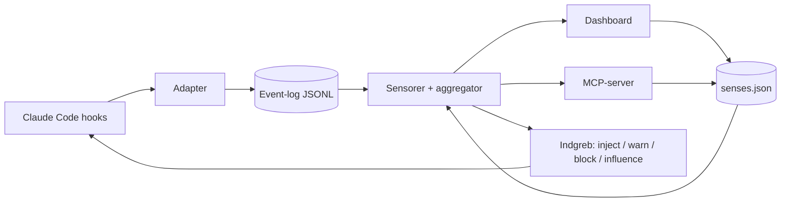

# PRD: Sanse-lag til AI-harnesses

**Projekt:** netsi-agent-senses (menneskelignende sanser til AI-agenter)
**Version:** 0.2 (udkast) · **Sidst opdateret:** 2026-10-19
**Ejer:** Sten Hougaard (netsi1964) · **Licens:** Apache-2.0 (som netsi-plugins)

---

## PRD-SEC-001 Overview & Objectives

### Koncept
Et sanse-lag, der oversætter menneskelige sanser og fornemmelser (smerte, indre fornemmelse, tidsfornemmelse, lugt, mavefornemmelse m.fl.) til målbare **sensorer** i en AI-harness. Sanserne måles løbende over harnessens events (tool-kald, exit codes, tokenforbrug, tidsstempler) og normaliseres til værdier mellem 0 og 1.

### Problem
- Agenten har ingen samlet fornemmelse af sin egen tilstand: en række fejlede kald, en fyldt kontekst eller en lang session bliver ofte først opdaget, når det er for sent.
- Mennesket har ikke et hurtigt overblik over, hvordan en session "har det".

### Formål
1. **Agenten regulerer sig selv:** sanserne læses via MCP og kan injicere instruktioner, udløse handlinger og ændre indstillinger.
2. **Mennesket får overblik og kontrol:** samme sanser vises i et dashboard og kan skrues på.
3. **Begge dele ligeligt:** agent og menneske deler ét billede af situationen og én konfiguration.

### Succeskriterier
| # | Kriterium | Mål |
|---|---|---|
| 1 | Installation som Claude Code-plugin | Under 5 minutter, ingen build-trin |
| 2 | Sanserne reagerer på rigtige events | Alle 4 V1-sanser giver readings i en levende session |
| 3 | Dashboard og agent ser samme værdier | Afvigelse under 2 sekunder |
| 4 | Agenten kan ikke slukke sine egne sanser | 0 tilfælde i test |
| 5 | Kernen er harness-agnostisk | Codex-adapter kan tilføjes uden ændringer i sensorer |

### Ikke-mål (V1)
- Ingen Codex-kode (kommer i fase 2).
- Ingen cloud-tjeneste: alt kører lokalt.
- Ingen læring/træning af sanserne; de er deterministiske regler.

---

## PRD-SEC-002 Target Audience

| Segment | Behov |
|---|---|
| **Primær:** udviklere, der arbejder dagligt med Claude Code | Tidlig advarsel om fejlspiral, fyldt kontekst og tempo |
| **Sekundær:** teams og konsulenter, der kører agenter længe | Fælles målinger og forudsigelig adfærd |
| **Tertiær:** forskere og nysgerrige | Udforske, om sanse-metaforen ændrer agentadfærd |

**Teknisk niveau:** Kan installere et plugin og redigere en JSON-fil. Kræver ikke Deno-kendskab.

---

## PRD-SEC-003 Core Features

### PRD-FEAT-001 Fælles eventformat og event-bus
Alle harness-events normaliseres til ét format, så sensorer aldrig kender harnessen.

```ts
type HarnessEvent = {
  ts: number;                       // ms siden epoch
  session: string;
  kind: "prompt" | "tool_call" | "tool_result" | "token_usage" | "turn_end";
  tool?: string;
  ok?: boolean;                     // kun tool_result
  exitCode?: number;
  tokens?: { used: number; limit?: number };
  source: "claude-code" | "codex";
};
```

**Acceptance criteria**
- PRD-FEAT-001.1 Events skrives append-only som JSONL til en lokal logfil.
- PRD-FEAT-001.2 Ugyldige eller ukendte events afvises uden at crashe kernen.
- PRD-FEAT-001.3 Formatet er versioneret (`schemaVersion`).

### PRD-FEAT-002 Sensor-interface og de fire V1-sensorer
Hver sans implementerer samme interface og regnes over et glidende vindue.

| Sans | Menneskelig sans | Beregning (udkast) | Datakilde |
|---|---|---|---|
| `pain` | Smertesans | Andel fejlede tool_results i vinduet; vægt på på hinanden følgende fejl | tool_result, exitCode |
| `interoception` | Indre fornemmelse | Brugt kontekst / grænse | token_usage |
| `time` | Tidsfornemmelse | Tid siden sidste brugerbesked og sessionens længde, normaliseret mod tærskler | prompt, ts |
| `smell` | Lugtesans | Antal lint-/anomali-signaler pr. tool_result (kun hvor lint kører) | tool_result |

**Acceptance criteria**
- PRD-FEAT-002.1 Hver reading indeholder `value` (0..1), `label`, `confidence` (0..1) og `ts`.
- PRD-FEAT-002.2 Sanser uden tilstrækkelig data returnerer lav `confidence`, ikke en opdigtet værdi.
- PRD-FEAT-002.3 Sensorer er rene funktioner af eventlisten (testbare uden harness).

### PRD-FEAT-003 Mavefornemmelse (aggregator)
En sammensat sans, der vægter de øvrige sanser til én samlet vurdering.

- PRD-FEAT-003.1 Vægtet gennemsnit af aktive sanser; vægte er konfigurerbare.
- PRD-FEAT-003.2 Gennemsnittet af `confidence` rapporteres med; høj værdi med lav confidence markeres eksplicit.
- PRD-FEAT-003.3 Deaktiverede sanser indgår ikke.

### PRD-FEAT-004 Konfiguration (`senses.json`)
Én kilde til sandhed, som både dashboard, MCP-server og hooks læser.

```ts
type SenseConfig = {
  enabled: boolean;
  gain: number;          // forstærkning
  threshold: number;     // 0..1, hvornår sansen slår til
  window: number;        // sekunder
  bounds: {              // sat af mennesket, se PRD-FEAT-009
    gain:      [number, number];
    threshold: [number, number];
    window:    [number, number];
  };
  action: "inform" | "warn" | "block" | "influence";
};
```

**Acceptance criteria**
- PRD-FEAT-004.1 Ændringer slår igennem i kernen uden genstart.
- PRD-FEAT-004.2 Ugyldig config afvises, og sidste gyldige config bevares.
- PRD-FEAT-004.3 Standardværdier følger med, så plugin'et virker ved første start.

### PRD-FEAT-005 MCP-server
Fælles flade, som modellen selv kan kalde.

| Tool | Funktion |
|---|---|
| `senses_read` | Returnerer alle aktive readings og mavefornemmelsen som JSON |
| `senses_set` | Ændrer `gain`, `threshold`, `window` inden for `bounds` |
| `senses_history` | Returnerer seneste readings (til trend) |

**Acceptance criteria**
- PRD-FEAT-005.1 `senses_set` afviser værdier uden for `bounds` med en forklarende fejl.
- PRD-FEAT-005.2 `senses_set` kan ikke ændre `enabled`, `bounds` eller `action`.
- PRD-FEAT-005.3 Serveren kører lokalt over stdio.

### PRD-FEAT-006 Dashboard (single-file HTML)
- PRD-FEAT-006.1 Ét custom element `<sense-gauge>` pr. sans: måler, label, confidence, historik (sparkline).
- PRD-FEAT-006.2 Kontroller til tænd/sluk, gain, threshold, window, handlingsgrad og min/max.
- PRD-FEAT-006.3 Sanser grupperet i kategorier (klassiske, kropslige, sociale, tidslige).
- PRD-FEAT-006.4 Lysmode som standard med dark toggle; ingen build-trin; ingen eksterne afhængigheder.
- PRD-FEAT-006.5 Opdaterer via SSE eller polling og skriver til `senses.json` via kernens lokale API.
- PRD-FEAT-006.6 Viser et tydeligt skift, når agenten har justeret en værdi (hvem, hvornår, fra/til).

### PRD-FEAT-007 Claude Code-plugin
Pakker det tekniske i ét hug.

- PRD-FEAT-007.1 **Hooks:** `PostToolUse`, `UserPromptSubmit`, `Stop` (og `PreToolUse` til blokering) skriver events til kernen.
- PRD-FEAT-007.2 **MCP-server** registreres automatisk (PRD-FEAT-005).
- PRD-FEAT-007.3 **Slash-kommando** `/senses` viser status og åbner dashboardet.
- PRD-FEAT-007.4 **Statuslinje** viser kompakt status, fx `pain 0.8 · ctx 0.9 · tid 0.2`.
- PRD-FEAT-007.5 **Skill** med adfærdsregler (hvad agenten gør, når en sans slår til), redigerbar som markdown.

### PRD-FEAT-008 Indgrebsmodel
Hver sans har en handlingsgrad, der vælges pr. sans:

| Grad | Virkning |
|---|---|
| `inform` | Status injiceres i konteksten ved næste prompt |
| `warn` | Tydelig advarsel (system-reminder + statuslinje), når tærsklen krydses |
| `block` | `PreToolUse`-hook afviser tool-kald, indtil tilstanden er afklaret |
| `influence` | Sansen kan injicere instruktion, udløse handling (fx komprimering, ny session, test-kørsel) og ændre indstillinger (permission mode, model, reasoning-niveau, plan mode) |

**Acceptance criteria**
- PRD-FEAT-008.1 Handlingsgrad kan kun ændres af mennesket (dashboard/fil).
- PRD-FEAT-008.2 `block` har altid en undtagelsesvej (menneskelig override), så agenten ikke låses fast.
- PRD-FEAT-008.3 Hver handling, der udløses af en sans, logges med årsag (sans, værdi, tærskel).
- PRD-FEAT-008.4 Handlinger, der ændrer indstillinger, er hvidlistet i konfigurationen.

### PRD-FEAT-009 Sikkerhedsmodel for selvjustering
Agenten må skrue, men aldrig blinde sig selv.

- PRD-FEAT-009.1 Agenten kan kun ændre `gain`, `threshold` og `window` **inden for min/max**, som mennesket har sat pr. sans.
- PRD-FEAT-009.2 Agenten kan aldrig slå en sans fra og aldrig ændre `bounds` eller `action`.
- PRD-FEAT-009.3 Alle agent-ændringer logges (PRD-FEAT-010) og vises i dashboardet.
- PRD-FEAT-009.4 Standardgrænser leveres, så et nyt plugin ikke starter med fuld frihed.

### PRD-FEAT-010 Audit-log
- PRD-FEAT-010.1 Alle readings, config-ændringer og udløste handlinger logges med tidsstempel og aktør (menneske/agent/system).
- PRD-FEAT-010.2 Loggen kan eksporteres og bruges til at forklare, hvorfor en sans slog til.
- PRD-FEAT-010.3 Rotation, så loggen ikke vokser ubegrænset.

### PRD-FEAT-011 Installation og dokumentation (open source)
- PRD-FEAT-011.1 README med installation, skærmbilleder og en "kom i gang på 5 minutter"-guide.
- PRD-FEAT-011.2 Dokumenteret sensor-interface, så andre kan bygge nye sanser.
- PRD-FEAT-011.3 Dokumenteret adapter-interface (forberedelse til Codex og andre harnesses).
- PRD-FEAT-011.4 Eksempler på skill-regler og konfigurationer.

---

## PRD-SEC-004 Technical Stack Recommendations

| Lag | Valg | Begrundelse |
|---|---|---|
| Kerne og MCP-server | Deno + TypeScript | Ingen build-trin, indbygget permissions, nem at distribuere som plugin |
| Dashboard | Single-file HTML, vanilla JS, custom elements, SVG | Ingen build, nem at forke og dele |
| Lagring | JSONL (events/audit) + JSON (config) | Læsbart, versionerbart, ingen database |
| Transport | MCP over stdio; lokal HTTP + SSE til dashboard | Simpelt og lokalt |
| Distribution | Claude Code plugin | Samler hooks, MCP, skill og kommando |
| Test | `deno test` med optagne event-forløb | Sensorer er rene funktioner |

**Arkitektur**



**Harness-agnostisk design:** kun adapteren kender harnessen. Codex-adapteren (fase 2) skal kun levere samme eventformat.

---

## PRD-SEC-005 Conceptual Data Model

**Event** (se PRD-FEAT-001)

**Reading**

| Felt | Type | Beskrivelse |
|---|---|---|
| `id` | string | Sansens id, fx `pain` |
| `value` | number 0..1 | Normaliseret værdi |
| `label` | string | Læsbar forklaring, fx "3 af 5 kald fejlede" |
| `confidence` | number 0..1 | Hvor sikker målingen er |
| `ts` | number | Tidspunkt |

**SenseConfig** (se PRD-FEAT-004)

**AuditEntry**

| Felt | Type | Beskrivelse |
|---|---|---|
| `ts` | number | Tidspunkt |
| `actor` | `human` / `agent` / `system` | Hvem |
| `type` | `config_change` / `action` / `threshold_crossed` | Hvad |
| `sense` | string | Berørt sans |
| `from` / `to` | any | Før og efter |
| `reason` | string | Årsag |

**Relationer:** Event → (mange) Readings; SenseConfig 1:1 Sense; AuditEntry refererer til Sense og evt. Reading.

---

## PRD-SEC-006 UI Design Principles

1. Lysmode som standard med dark toggle.
2. Font-stack: Avenir, Montserrat, Corbel, 'URW Gothic', source-sans-pro, sans-serif; normal vægt.
3. Overblik først: mavefornemmelsen øverst, de enkelte sanser nedenunder.
4. Farve må aldrig være eneste signal (tal og label vises altid).
5. Confidence vises visuelt, så en gætte-sans ikke ligner en målt sans.
6. Agentens ændringer er tydeligt markeret, så mennesket altid kan se, hvem der skruede.
7. Responsivt og tilgængeligt (tastaturnavigation, kontrast).
8. Simple modeller vises som rigtige tabeller, ikke ASCII-kunst.

**Wireframes:** Ingen endnu. Første skitse af dashboardet leveres i fase 1.

---

## PRD-SEC-007 Security Considerations

| Risiko | Tiltag |
|---|---|
| Agenten blinder sig selv (sænker/hæver tærskler, slukker sanser) | PRD-FEAT-009: min/max, ingen `enabled`/`action`/`bounds` via MCP |
| Hooks blokerer så agenten låses fast | Undtagelsesvej og tidsudløb på `block` |
| Logs indeholder følsomt indhold (kode, stier, prompts) | Log kun metadata (tool, ok, exitCode, tokens), ikke indhold; lokal lagring |
| Lokal dashboard-server nås udefra | Bind kun til `127.0.0.1`, tilfældigt token i URL |
| Prompt injection via injicerede statusbeskeder | Injicér kun strukturerede, kortfattede værdier, aldrig rå logtekst |
| Handlinger, der ændrer indstillinger, misbruges | Hvidliste i konfigurationen, alt logges |
| Deno-permissions for vide | Kun nødvendige `--allow-read/write` til plugin-mappen |

---

## PRD-SEC-008 Development Phases

| Fase | Indhold | Leverance |
|---|---|---|
| **0 Fundament** | Eventformat, sensor-interface, config-skema, testdata | Specifikation og tests |
| **1 V1 (Claude Code)** | PRD-FEAT-001 til 011: fire sanser + mavefornemmelse, MCP, dashboard, hooks, skill, `/senses`, statuslinje, sikkerhedsmodel, audit | Installérbart plugin |
| **2 Codex** | Codex-adapter (log-tail og `notify`), AGENTS.md-opskrift, genbrug af skill hvis understøttet | Codex-støtte |
| **3 Flere sanser** | De resterende sanser (syn, hørelse, smag, balance, proprioception, empati, tillid m.fl.) | Udvidet sansesæt |
| **4 Fællesskab** | Plugin-API til egne sanser, eksempler, dokumentation | Økosystem |

**Anbefalet sprint-rækkefølge i fase 1:** 001 → 002 → 004 → 005 → 007 (hooks) → 003 → 006 → 008 → 009 → 010 → 011.

---

## PRD-SEC-009 Challenges & Solutions

| Udfordring | Løsning |
|---|---|
| Nogle sanser kan kun måles, hvis harnessen eksponerer data (fx tokenfyldning) | `confidence` på hver reading; fald tilbage til estimat fra transcript |
| Hook-formater og transcript-formater ændrer sig | Tynd adapter, versioneret eventformat, tests mod optagede forløb |
| For mange advarsler giver støj | Hysterese og cooldown pr. sans; tærskel og vindue kan justeres |
| `block` kan skabe dødvande | Undtagelsesvej, tidsudløb, menneskelig override |
| Sanse-metaforen kan blive pynt uden effekt | Mål effekt (færre fejlspiraler, tidligere komprimering) og dokumentér |
| Mavefornemmelsen kan skjule enkeltsignaler | Vis altid de enkelte sanser sammen med aggregatoren |
| Selvjusterende agent kan oscillere | Begræns ændringsfrekvens og størrelse pr. justering |

---

## PRD-SEC-010 Future Expansions

- Codex- og Gemini CLI/Aider-adaptere
- De resterende ca. 15 sanser (se oversigtstabellen)
- Fælles sansedata på tværs af sessioner og harnesses (sammenligning)
- Delte "sansprofiler" (fx konservativ, hurtig, forsigtig)
- Eksport til Grafana/OpenTelemetry
- Valgfri sansning af flere agenter i samme workflow (sociale sanser)

---

## Åbne spørgsmål

1. ~~Licens~~ Besluttet i 0.2: Apache-2.0.
2. ~~Projektnavn~~ Besluttet i 0.2: `netsi-agent-senses`.
3. Hvor præcist kan kontekstfylde læses i Claude Code (statuslinje-input, transcript)? Skal verificeres mod aktuel version.
4. Hvilke indstillinger må `influence` ændre i V1 (hvidlisten)?
5. Skal dashboardet kunne vise flere sessioner samtidig?
6. Skal der være en "dry run"-tilstand, hvor sanser kun logger uden at gribe ind?
7. Hvordan måles, om sanserne faktisk forbedrer agentens adfærd?

## Ændringslog

- 0.1 (2026-10-19): Første udkast ud fra dialog: målgruppe open source, begge formål ligeligt, V1 med fire sanser + mavefornemmelse, alle indgrebsgrader plus påvirkning, min/max-sikkerhed, Claude Code-plugin i V1 og Codex i fase 2.
- 0.2 (2026-10-19): Projektnavn besluttet (`netsi-agent-senses`) og licens besluttet (Apache-2.0). Åbne spørgsmål 1 og 2 lukket. PRD flyttet til `development/PRD.md`.
